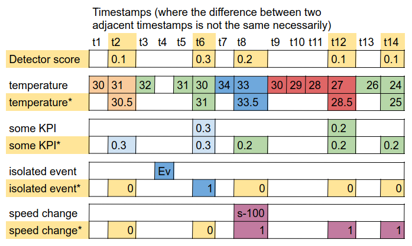

# Concepts

## Target and sources

- **Target**: the series the context is built for, usually the anomaly scores of a detector. Every new target
  sample creates a context, and the target defines the sample rate of the context.
- **Sources**: every other series (sensors, events, configuration changes, categorical states). Each sample is
  identified by its `name` and `source`; in a context it appears as `name@source`.

## Context horizon

The time window used to build each context, e.g. `"8 hours"` (units: `seconds`, `minutes`, `hours`, `days`; a
plain number means hours). A context at time `t` contains the samples in `[t - horizon, t]`.

## The Context object

[`Context`](api/structure.md) has:

- **timestamp**: the time of the target sample which created it.
- **CD** (context data): a dictionary `name -> series`, all series with the same length as the target series
  (one value per target sample in the horizon). A source without data in the window has `None`.
- **CR** (context relationships): a dictionary with
    - `edges`: list of `(cause, effect)` pairs found by the causality discovery function,
    - `characterization`: a parallel list with `increase`, `decrease` or `unknown` for each edge,
    - `interpretation`: list of `(cause, target, characterization, timestamp)`, the edges which explain the target,
      ordered by the time they first appeared.

## Source types

The `type` of a source defines how its samples become a series aligned with the target (see
[Mapping functions](mapping-functions.md)):

| type | meaning | series |
|---|---|---|
| `Univariate` | continuous values | values aligned to the target sample rate |
| `isolated` | events with instant impact | 1 at the event, 0 elsewhere |
| `configuration` | events with a lasting impact | +1 after each event |
| `categorical` | a categorical state | one 0/1 series per category, and a state series |
