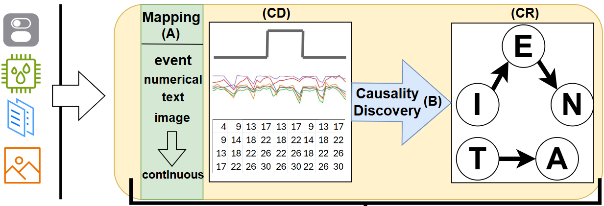

# PdmContext

???+ warning "Notice for existing users: what changed in version 0.3.0"

    --8<-- "CHANGELOG.md:notice"

**Context** encapsulates all available multimodal information around a target signal (usually anomaly scores),
towards better anomaly detection and predictive maintenance solutions.

A context represents the data observed in a time window (the **context horizon**), mapped from their multimodal
form (sensor values, events, configuration changes, categorical states) to a multivariate time series (**CD**), and
the relationships between them (**CR**), extracted with **causal discovery**.



Context generation is an online process: data are collected as they arrive, and each new value of the **target**
series creates a new context.

## Installation

```bash
pip install PdmContext
```

The causality discovery method is pluggable. Optional dependencies:

```bash
pip install PdmContext[pc]        # gCastle PC (and torch), used by the default causality function
pip install PdmContext[movingpc]  # deprecated MovingPC (gCastle + scipy)
pip install PdmContext[pca]       # PCA based context distance (scikit-learn)
pip install PdmContext[influxdb]  # InfluxDB storage
```

## Quick start

```python
import pandas as pd
from PdmContext.ContextGeneration import ContextGenerator
from PdmContext.utils.causal_discovery_functions import calculate_with_pc

con_gen = ContextGenerator(target="anomaly scores", context_horizon="8 hours", Causalityfunct=calculate_with_pc)

t = pd.Timestamp("2024-01-01 10:00")
con_gen.collect_data(timestamp=t, source="Machine_A", name="temperature", value=40.5)
con_gen.collect_data(timestamp=t, source="Machine_A", name="speed change", type="configuration")

# a sample of the target series creates a context
context = con_gen.collect_data(timestamp=t, source="Machine_A", name="anomaly scores", value=0.3)

context.CD   # {"anomaly scores": [...], "temperature@Machine_A": [...], "speed change@Machine_A": [...]}
context.CR   # {"edges": [...], "characterization": [...], "interpretation": [...]}
```

Continue with [Concepts](concepts.md) and [Generating context](generating-context.md).
