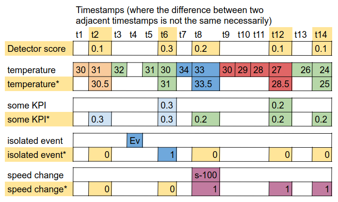

# Mapping functions

A mapping function transforms the samples of a source in the context window into series of the same length as the
target series. `mapping_functions` is a dictionary `type -> mapper`; the default is:

```python
from PdmContext.utils.mapping_functions import (map_univariate_to_continuous, map_isolated_to_continuous,
                                                map_configuration_to_continuous, map_categorical_to_continuous)

mapping_functions = {
    "Univariate": map_univariate_to_continuous(),         # continuous sources
    "isolated": map_isolated_to_continuous(),             # events with instant impact
    "configuration": map_configuration_to_continuous(),   # events with constant impact
    "categorical": map_categorical_to_continuous(),       # categorical values
}
```

The default mappers keep state per source, so each `ContextGenerator` needs its own mapper objects.

## Default mappers

**Univariate**: for sources with a higher sample rate than the target, the samples between two target timestamps
are averaged; for lower sample rates the last value is repeated.

**isolated**: a 0 series with 1 at the target timestamp of each event.

**configuration**: a series which increases by 1 after each event. Each window starts from 0, so the values stay
bounded in endless streams (only the changes matter).

**categorical**: one 0/1 series `{category}_{name}` per category, 1 while the category is active, and a series
`state_{name}`, 1 after the last change of category. Categorical values may be sent only when they change: the
last value is kept even when it is older than the horizon, so the category active at the start of the window is
known. Before the first known value no category is active.



## Custom mappers

A mapper is any object with a `map` method:

```python
class map_counter:
    def map(self, target_series, occurrences, name):
        """
        target_series: [(value, timestamp), ...] of the target in the window (defines the positions)
        occurrences:   [(value, timestamp), ...] of the source in the window
        name:          name@source of the source
        return: (list of series, list of names), each series with len(target_series) values
        """
        counts = [sum(1 for _, t in occurrences if t <= ts) for _, ts in target_series]
        return [counts], [f"count_{name}"]

con_gen = ContextGenerator(target="score", mapping_functions={"Univariate": map_univariate_to_continuous(),
                                                              "counter": map_counter()})
con_gen.collect_data(timestamp=t, source="m", name="door", type="counter")
```

Set the class attribute `keep_last_before_horizon = True` when the mapper needs the last sample of the source
before the window (as for categorical values sent only on change).

Interpretation (`CR["interpretation"]`) is computed only with the default mappers.
